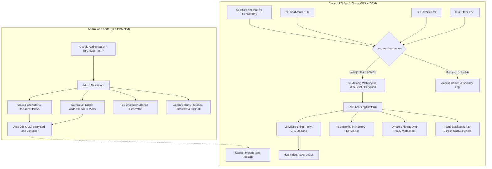

# Secure Course DRM Platform (Enterprise Edition)

[](https://nodejs.org/)
[](https://developer.mozilla.org/en-US/docs/Web/API/SubtleCrypto)
[]()
[]()
[](https://vercel.com/)

A modular, enterprise-grade Digital Rights Management (DRM) course publishing and PC playback ecosystem. Built to guarantee that educational media (videos, encrypted PDFs, modules, and lessons) cannot be shared, pirated, ripped via network inspection, screen-recorded, screen-shared, or accessed on mobile devices.

---

## 📑 Table of Contents
1. [Architecture & System Design](#-architecture--system-design)
2. [Folder Structure](#-folder-structure)
3. [10-Point Engineering Refactoring](#-10-point-engineering-refactoring)
4. [State Management](#-state-management)
5. [Scalable REST API Reference](#-scalable-rest-api-reference)
6. [Resilience & Crash Prevention](#-resilience--crash-prevention)
7. [Security & DRM Defense in Depth](#-security--drm-defense-in-depth)
8. [Getting Started & Local Setup](#-getting-started--local-setup)
9. [Vercel Deployment Guide](#-vercel-deployment-guide)
10. [Default Admin Credentials & Test Course](#-default-admin-credentials--test-course)

---

## 🏗️ Architecture & System Design



---

## 📂 Folder Structure

The project adheres to a clean, modular Model-View-Controller (MVC) server architecture and an event-driven, component-based frontend architecture:

```text
secure-course-drm/
├── .env.example                       # Environment template
├── package.json                       # Dependencies & scripts
├── vercel.json                        # Serverless deployment configuration
├── README.md                          # Documentation
│
├── server/                            # Backend API & DRM Server
│   ├── index.js                       # HTTP server entrypoint with process crash guards
│   ├── app.js                         # Express app assembly & middleware pipeline
│   ├── db.js                          # Thread-safe persistent JSON database
│   ├── config/
│   │   └── index.js                   # Centralized configuration (ports, secrets, paths)
│   ├── controllers/
│   │   ├── authController.js          # Admin login, TOTP 2FA, session, password management
│   │   ├── courseController.js        # Course list, preview, encrypt, update, download, delete
│   │   ├── licenseController.js       # 56-char license generation, list, revoke, reset HWID/IP
│   │   ├── clientController.js        # Student inspection, activation, heartbeat, tamper alert
│   │   ├── streamController.js        # DRM playlist/segment stream proxy with token verification
│   │   └── logController.js           # Security audit log inspection & query
│   ├── middleware/
│   │   ├── auth.js                    # HMAC-SHA256 & memory session authentication guard
│   │   └── errorHandler.js            # Central error handler & asyncHandler wrapper
│   ├── routes/
│   │   ├── index.js                   # Unified route index mounted on /api
│   │   ├── authRoutes.js              # /api/auth endpoints
│   │   ├── courseRoutes.js            # /api/courses endpoints
│   │   ├── licenseRoutes.js           # /api/licenses endpoints
│   │   ├── clientRoutes.js            # /api/client endpoints
│   │   ├── streamRoutes.js            # /api/drm/stream endpoints
│   │   └── logRoutes.js               # /api/logs endpoints
│   └── utils/
│       ├── network.js                 # Dual-stack IPv4/IPv6 resolution & mobile device detector
│       ├── token.js                   # Stateless HMAC admin token & 56-character key generator
│       └── storage.js                 # Course container disk file operations
│
├── student-app/                       # Student PC DRM Application
│   ├── index.html                     # Responsive desktop player shell
│   ├── app.js                         # Application coordinator & event wiring
│   ├── styles.css                     # Dark-mode desktop LMS styles
│   └── js/
│       ├── api.js                     # Student API client service (inspect, activate, heartbeat)
│       ├── crypto.js                  # In-memory WebCrypto AES-256-GCM decryptor
│       ├── state.js                   # Centralized reactive student state store
│       ├── security.js                # Focus shield, mobile block, screenshot traps, DevTools guard
│       ├── player.js                  # HLS.js video streaming & DRM proxy manager
│       └── pdfViewer.js               # In-memory PDF.js canvas renderer & iframe fallback
│
├── admin-portal/                      # Administrator Management Portal
│   ├── index.html                     # Admin SPA interface
│   ├── app.js                         # Portal orchestrator & lifecycle manager
│   ├── styles.css                     # Modern dark-theme admin UI styling
│   └── js/
│       ├── config.js                  # API endpoints and client constants
│       ├── toast.js                   # Non-blocking animated UI toast notifications
│       ├── state.js                   # Reactive administrative state store
│       ├── api.js                     # Authenticated fetch wrapper with Bearer token injection
│       ├── services/
│       │   ├── authService.js         # Authentication, credentials & 2FA workflows
│       │   ├── courseService.js       # Course upload, curriculum update & deletion
│       │   ├── licenseService.js      # 56-character license issuing, reset & revocation
│       │   └── logService.js          # Security audit logs retrieval
│       └── components/
│           ├── tableRenderers.js      # Course cards, license table, and audit logs renderer
│           ├── courseEditor.js        # Interactive curriculum editor modal component
│           └── licenseModal.js        # 56-character license creation modal component
│
└── desktop-wrapper/                   # PC-Only Desktop Runner (Electron)
    ├── package.json
    ├── main.js                        # Hardware UUID extraction & single-instance enforcement
    └── preload.js                     # Secure context bridge for PC environment
```

---

## 🎯 10-Point Engineering Refactoring

1. **Clean Folder Structure**: Modularized the monolithic server, admin portal, and student app into clearly designated directories (`server/controllers`, `server/routes`, `server/middleware`, `server/config`, `server/utils`, `student-app/js`, `admin-portal/js/components`, `admin-portal/js/services`).
2. **Separation of Business Logic from UI**: UI templates and DOM manipulation are isolated in dedicated components (`tableRenderers.js`, `courseEditor.js`, `licenseModal.js`), while business operations live in headless service classes (`courseService.js`, `licenseService.js`, `studentApi`).
3. **Consistent Naming Conventions**:
   - Classes: `PascalCase` (`SecurityManager`, `VideoPlayerManager`, `AdminStore`).
   - Functions & Methods: `camelCase` (`getClientIps`, `createAdminToken`, `issueLicense`).
   - Filenames: `camelCase` or lowercase with hyphens (`authController.js`, `errorHandler.js`).
4. **Proper Error Handling Everywhere**:
   - Backend: All Express route handlers are wrapped with `asyncHandler`, ensuring any promise rejection is captured by the central `errorHandler` without crashing the process.
   - Frontend: Native blocking `alert(...)` popups have been replaced with a non-blocking UI `Toast` system (`Toast.success`, `Toast.error`, `Toast.warning`, `Toast.info`).
5. **Separation of Environment Configs**:
   - Consolidated all server environment variables into `server/config/index.js` with comprehensive defaults and auto-detection for Vercel serverless `/tmp` storage.
   - Provided `.env.example` for local and staging deployments.
6. **Modular Reusable Components**:
   - `courseEditor.js`: Standalone modal component for dynamically adding/removing syllabus modules and lessons.
   - `licenseModal.js`: Modal component for issuing 56-character keys with custom duration, IP binding, and hardware locking.
   - `toast.js`: Animated notification engine.
   - `player.js` & `pdfViewer.js`: Isolated media rendering subsystems.
7. **Proper State Management**:
   - Implemented reactive Pub/Sub stores (`adminStore` and `studentStore`) providing predictable, unidirectional data flow across components.
8. **Scalable API Structure**:
   - Decomposed monolithic API routing into route modules mounted cleanly on `/api`.
9. **Zero Crash Reliability**:
   - Guarded process with global `uncaughtException` and `unhandledRejection` traps.
10. **Documentation**:
    - Comprehensive codebase and architectural guide.

---

## ⚡ State Management

Both client applications utilize lightweight, reactive stores following the Publisher-Subscriber pattern:

### Admin State Store (`admin-portal/js/state.js`)
```javascript
import { adminStore } from './js/state.js';

// Subscribe to state changes
const unsubscribe = adminStore.subscribe((state) => {
  console.log('Courses updated:', state.courses);
});

// Update state immutably
adminStore.setCourses(newCourseList);
```

### Student State Store (`student-app/js/state.js`)
```javascript
import { studentStore } from './js/state.js';

studentStore.subscribe((state) => {
  // Automatically re-render active module / lesson
});

studentStore.setSession({
  licenseKey: '...',
  token: '...',
  course: decryptedCourseData
});
```

---

## 🌐 Scalable REST API Reference

All endpoints are prefixed with `/api`.

### 1. Authentication & Admin Security (`/api/auth`)
| Method | Endpoint | Description | Auth Required |
|---|---|---|---|
| `POST` | `/api/auth/login` | Authenticate with Login ID, Password, and 6-digit TOTP code | No |
| `GET` | `/api/auth/status` | Check token validity & active admin status | Yes (Bearer) |
| `GET` | `/api/auth/setup-info` | Fetch current 2FA status and pairing information | Yes (Bearer) |
| `POST` | `/api/auth/new-secret` | Generate a new TOTP secret & pairing QR code | Yes (Bearer) |
| `POST` | `/api/auth/update-credentials` | Update admin login ID, password, or confirm new TOTP secret | Yes (Bearer) |
| `POST` | `/api/auth/logout` | Invalidate current admin session | Yes (Bearer) |

### 2. Course Management (`/api/courses`)
| Method | Endpoint | Description | Auth Required |
|---|---|---|---|
| `GET` | `/api/courses` | List all encrypted courses and module stats | Yes (Bearer) |
| `POST` | `/api/courses/preview-doc` | Upload and preview syllabus from `.docx`, `.doc`, or `.txt` | Yes (Bearer) |
| `POST` | `/api/courses/encrypt` | Encrypt a course container using AES-256-GCM | Yes (Bearer) |
| `PUT` | `/api/courses/:id/syllabus` | Add, update, or remove modules/lessons from course container | Yes (Bearer) |
| `GET` | `/api/courses/:id/download` | Download encrypted `.enc` container file | Yes (Bearer) |
| `DELETE` | `/api/courses/:id` | Delete course package and metadata | Yes (Bearer) |

### 3. License Generation & Management (`/api/licenses`)
| Method | Endpoint | Description | Auth Required |
|---|---|---|---|
| `POST` | `/api/licenses/issue` | Generate an exact **56-character** secure license key | Yes (Bearer) |
| `GET` | `/api/licenses` | List all student licenses, bound IPs, and HWIDs | Yes (Bearer) |
| `POST` | `/api/licenses/:id/revoke` | Revoke a license instantly | Yes (Bearer) |
| `POST` | `/api/licenses/:id/reset-device` | Clear bound HWID, IPv4, and IPv6 to allow PC re-pairing | Yes (Bearer) |

### 4. Student Client DRM (`/api/client`)
| Method | Endpoint | Description | Auth Required |
|---|---|---|---|
| `POST` | `/api/client/inspect` | Inspect `.enc` header (course ID, title, encryption salt) | No |
| `POST` | `/api/client/activate` | Verify 56-char license, bind dual IPv4/IPv6 + HWID, return stream token | No (PC only) |
| `POST` | `/api/client/heartbeat` | Maintain active session & verify single-instance playback | Yes (Stream Token) |
| `POST` | `/api/client/tamper-alert` | Report client tampering, screenshot hotkey attempts, or devtools opening | No |
| `GET` | `/api/client/package/:id` | Download or auto-load `.enc` course package | No |

### 5. DRM Stream Proxy (`/api/drm/stream`)
| Method | Endpoint | Description | Auth Required |
|---|---|---|---|
| `GET` | `/api/drm/stream/playlist.m3u8` | Proxied HLS master playlist with masked segment URLs | Yes (`?token=...`) |
| `GET` | `/api/drm/stream/segment.ts` | Proxied HLS video segment chunk | Yes (`?token=...`) |

### 6. Security Audit Logs (`/api/logs`)
| Method | Endpoint | Description | Auth Required |
|---|---|---|---|
| `GET` | `/api/logs` | Fetch real-time security events (logins, blocks, activations, tamper alerts) | Yes (Bearer) |

---

## 🛡️ Security & DRM Defense in Depth

1. **56-Character Cryptographic License Keys**:
   - Every generated license key is formatted with cryptographically secure random alphanumeric bytes (`A-Z0-9`), exactly 56 characters in length (e.g., `RP88278T3A4UTFBDNYVTL8EYD8BUCCJUX23RYU9DX8BCA22Y4ERD5FFB`).
2. **Dual-Stack IPv4 & IPv6 Single-Network Binding**:
   - During student activation, the server captures both IPv4 and IPv6 addresses.
   - If a license is shared with a user outside the bound home network, the server rejects playback with HTTP 403.
3. **PC-Only Enforcement & Mobile Blocking**:
   - The student activation pipeline analyzes User-Agent headers, touch pointer capabilities, and platform descriptors.
   - Mobile devices (Android, iOS, iPadOS) receive immediate `403 Forbidden` responses.
4. **Hardware ID (HWID) Binding**:
   - Bound to the student's unique machine hardware GUID.
   - Attempting to use the license on another PC triggers an HWID mismatch rejection.
5. **Anti-Screen Capture & Focus Shield**:
   - When the student player loses window focus (e.g., switching to OBS Studio or Discord), a blackout shield immediately masks the entire video canvas and document content.
   - Global keyboard shortcuts for capturing screens (`PrintScreen`, `Win+Shift+S`, `Ctrl+P`, `Meta+Shift+3/4`) are intercepted and cleared from the system clipboard.
   - Browser screen-sharing APIs (`navigator.mediaDevices.getDisplayMedia`) are overridden to prevent screen broadcasting.
6. **Network Inspection Masking (DRM Streaming Proxy)**:
   - Raw video URLs (Wistia, Cloudfront, AWS S3) are never exposed in student network requests.
   - Media flows through `/api/drm/stream/playlist.m3u8?token=...` with ephemeral, session-bound verification tokens.
7. **Dynamic Moving Watermark**:
   - An anti-piracy watermark displaying the student's name, bound IP, and live timestamp continuously hops across the playback view every 12 seconds to deter physical camera recording.

---

## 🚀 Getting Started & Local Setup

### 1. Prerequisites
- **Node.js**: v18.0.0 or higher
- **Operating System**: Windows 10/11 (64-bit recommended)

### 2. Installation
```powershell
# Clone or navigate to the repository
cd C:\Users\Lenovo\.gemini\antigravity\scratch\secure-course-drm

# Install dependencies
npm install
```

### 3. Environment Configuration
Copy `.env.example` to `.env`:
```powershell
cp .env.example .env
```
Default configuration values:
```env
PORT=3000
JWT_SECRET=secure-course-drm-stateless-jwt-secret-key-2026-xyz
STORAGE_DIR=./storage
CORS_ORIGIN=*
```

### 4. Run the Server
```powershell
npm run server
```
- **Admin Management Portal**: [http://localhost:3000/admin](http://localhost:3000/admin)
- **Student DRM Player**: [http://localhost:3000/student](http://localhost:3000/student)
- **Health Check**: [http://localhost:3000/api/health](http://localhost:3000/api/health)

---

## ☁️ Vercel Deployment Guide

The platform is pre-configured for seamless serverless deployment on Vercel:

1. Push your repository to GitHub.
2. In the [Vercel Dashboard](https://vercel.com/dashboard), import your repository (`jdkjwelhdwhoi-ldw`).
3. Set the Root Directory to `./` and ensure Node.js 18.x or 20.x is selected.
4. Add the following Environment Variables in the Vercel Project Settings:
   - `JWT_SECRET`: A long random secret string.
   - `ADMIN_LOGIN_ID`: Your desired admin username.
   - `ADMIN_PASSWORD`: Your admin password.
   - `TOTP_SECRET`: Your 32-character base32 authenticator secret.
5. Deploy. `vercel.json` will automatically route API traffic to `server/index.js` and serve the `/admin` and `/student` single-page applications.

---

## 🔑 Default Admin Credentials & Test Course

### Default Administrator Login
- **Portal URL**: [http://localhost:3000/admin](http://localhost:3000/admin)
- **Login ID**: `shubhg9401`
- **Password**: `admin123`
- **TOTP Authenticator Secret**: `JBSWY3DPEHPK3PXPJBSWY3DPEHPK3PXP`
  *(Enter this secret into Google Authenticator or Microsoft Authenticator, or scan the QR code displayed on the login page)*

### Pre-Seeded Test Course: Sigma 12
- **Course Name**: Sigma 12
- **Pre-Generated 56-Character License**:
  ```text
  RP88278T3A4UTFBDNYVTL8EYD8BUCCJUX23RYU9DX8BCA22Y4ERD5FFB
  ```
- **Verification Steps**:
  1. Open [http://localhost:3000/student](http://localhost:3000/student) on a Windows PC.
  2. Click **"Auto-Load Sigma 12 Package"**.
  3. Paste the 56-character license key.
  4. Click **"Verify 56-Char Key & Decrypt Course"** to start playback.

---

## 🔒 Private Repository
- **GitHub**: [https://github.com/shubhG-9401/jdkjwelhdwhoi-ldw](https://github.com/shubhG-9401/jdkjwelhdwhoi-ldw)
